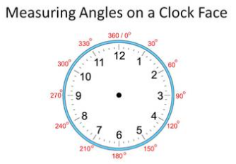

# Instructions  
Write a program that takes three inputs - hours, minutes, and seconds that have passed since midnight. Print the angle (in degrees) of the hour hand on the clock face at this time.

  ## Steps
  1. Get three numbers as `input()` - `h` (hours since midnight), `m` (minutes since midnight) and `s` (seconds since midnight).
  2. `print()` the angle (in degrees) of the hour hand on the clock face at this time.

  

  ## Hint
  * Each hour is 30 degrees
  * Each minute is 30 degrees divided by 60
  * Each second is 30 degrees divided by 3600

  ## Example
  ### Input
  `4`
  
  `54`
  
  `55`

  ### Output
  `147.458`

  